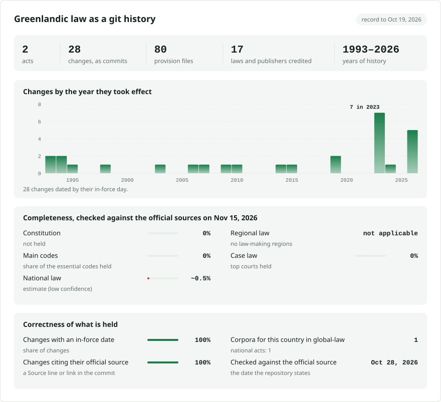

# Greenland: law history in git

[Dansk](README.md) · **English**

<picture>
<source media="(prefers-color-scheme: dark)" srcset="data/effort-dark.svg">

</picture>

The law of Greenland as a git history: one file per section (§), one commit per amending act on the day it took effect, and the act that made each change as the commit's author. `git blame` names the act behind every line; `git log` lists every change to a section; picking a date gives the text in force that day.

Part of [lexifina/global-law](https://github.com/lexifina/global-law), one git history for every country's law: this is Greenland's national law, which global-law reads at `greenland/national/acts/`.

**What is in it now:** 2023 texts from Nalunaarutit, Greenland's official law collection: 934 Greenlandic acts, forordninger and bekendtgørelser (from 1979), 874 Danish acts, anordninger and bekendtgørelser for Greenland (Rigslovgivning) and 215 treaties; 135 consolidations, 569 amending acts on their in-force day and 294 repeals. The Church Act (`inatsisartutlove/2010/kirken/`) and the Port Dues Act (`landstingslove/1992/havneafgift/`) are replayed change by change. [`acts.csv`](data/acts.csv) lists every folder; [`held.csv`](data/held.csv) what was left out and why.

Each act is a folder, sorted by type and year (`landstingslove/1992/havneafgift/`, `bekendtgoerelser/2019/bekendtgoerelse-2019-30/`, `rigslovgivning/love/2025/lov-2025-1766/`, the Self-Government Act in `grundlag/`, repealed texts in each type's `ophaevede/`), and each section is one file: `landstingslove/1992/havneafgift/par-012.md` is § 12 of the Port Dues Act, `inatsisartutlove/2010/kirken/par-026a.md` § 26 a of the Church Act. Each folder's `README.md` lists its sections and how often each changed.

The text is in Danish, as Grønlands Selvstyre publishes it in Nalunaarutit. The Greenlandic text it also publishes, and an English translation, are not part of this record.

## Questions as git commands

| Question | Command |
| --- | --- |
| Every change to § 12 of the Port Dues Act | `git log -p --word-diff -- landstingslove/1992/havneafgift/par-012.md` |
| Which act wrote each line of § 12? | `git blame landstingslove/1992/havneafgift/par-012.md` |
| Every version of § 12, with the day each took effect | `git log --format="%h %(trailers:key=In-force,valueonly,separator=) %an" -- landstingslove/1992/havneafgift/par-012.md` |
| § 12 as in force on 1 January 2000 | `python tools/paa_dato.py 2000-01-01 havneafgift 12` |

**Outside git**, we also host this record publicly, for free:

- **[Ask Claude about Greenlandic law](https://global-law.lexifina.com/v1/try_claude?country=greenland)**: opens Claude with a first question ready.
- **[Ask ChatGPT](https://global-law.lexifina.com/v1/try_chatgpt?country=greenland)**: the same question in ChatGPT.
- **[Search Greenlandic law on our site](https://lexifina.com/law?country=greenland&q=havneafgift)**: a search for "havneafgift", with each provision's text and its versions, no account needed.
- **[Developer REST API](https://global-law.lexifina.com/v1/search_law?query=havneafgift&jurisdiction=greenland)**: the same search as JSON, with no key. See the [documentation here](https://lexifina.com/api/global-law).

Both assistants read the record through the free Global law connector (MCP, `https://global-law.lexifina.com/mcp`); the first time, the chat gives you the link that adds it. Ask in Danish or in English.

**Host it yourself easily.** All it takes is git and Python, and the tools run on your machine:

```sh
git clone --depth 1 https://github.com/lexifina/global-law && cd global-law
python3 tools/countries.py add greenland/national/acts
python3 tools/law.py show 2026-01-01 greenland/national/acts/landstingslove/1992/havneafgift/par-012.md
```

Opened in Claude Code, Cursor, VS Code or Codex, the clone also starts a local MCP server with the same tools ([MCP.md](https://github.com/lexifina/global-law/blob/main/MCP.md)).

## Dates

Each commit is dated at noon, America/Nuuk, on the day the version took effect, and carries it in its `In-force:` trailer, beside the day the act was passed and designated (`Enacted:`):

- for an amending act, and for each act as passed, the day its own commencement sentence gives ("Inatsisartutloven træder i kraft den 1. januar 2019"), quoted in the commit; where it cannot be read, the day of the next consolidation (`Date-note: undated`);
- for a consolidation, the day in its designation (nr. 41 af 19. oktober 2026: 19 October 2026).

Each change is credited to the amending act that a consolidation's endnote, or the act's own amending article, names for that section (`Inatsisartutlov nr. 61 af 20. november 2023`); the first version of an act is credited to the act itself. Changes more than one act could explain (named in `Candidate:` trailers), changes no act explains, changes printed before their act takes effect (`Printed-early:`) and each consolidation's own words are committed by `Nalunaarutit (Grønlands Selvstyre)`, never credited to an act on a guess.

## How it is checked

- `tools/check_repo.py` reads each of the 5 official texts back from git on the day it took effect and compares it file by file with the text parsed from Nalunaarutit's HTML (0 mismatches), and word for word with the whole official page read without the parser (12,159 words, 0 mismatches).
- `tools/test_repo.py` checks that blame names an act, that the dated tool gives the text before and after an amendment, that every tag resolves and that every law commit carries `In-force:`.
- A second build from the same retrieved pages gave the same hash for each of the 28 law commits and 38 tags. The commands and results are in [`REPRODUCE.md`](REPRODUCE.md).
- History is append-only: later builds are appended, and no published commit is rewritten.
- [data/vulnerabilities/](data/vulnerabilities/README.en.md): possible drafting mistakes in this law, found by global-law's detectors and checked by hand. Not run yet.

## What it does not show

- **Text between official versions** outside `inatsisartutlove/2010/kirken/` and `landstingslove/1992/havneafgift/`: an amending act is recorded in the act's `aendringslove/` folder on its in-force day, but the act's section files change only with the next official consolidation (`Text-applied: no` in the commit).
- **The Self-Government Act** (lov nr. 473 af 12. juni 2009), Greenland's constitutional basis: it is a Danish act, published on Retsinformation, and is in [denmark-law](https://github.com/lexifina/denmark-law/tree/main/lov/2009/473).
- **The days between official texts as official texts.** Nalunaarutit publishes a text only as passed and on each consolidation's day; between them, each act's changes are placed on its own in-force day with the wording the next consolidation shows. Only the commits tagged `il/2010-9`, `ltl/1992-20` and `lbk/<year>-<number>` are official texts.
- **The Church Act as in force from 19 October 2026 to 31 December 2026.** That day's consolidation prints Inatsisartutlov nr. 29 af 25. juni 2026, which takes effect on 1 January 2027; its changes to § 3 a and § 24 stand here from 19 October 2026, labelled `Printed-early:`.

## Sources

| Source | Kind | Past versions | Notes |
| --- | --- | --- | --- |
| [Nalunaarutit](https://nalunaarutit.gl) (Grønlands Selvstyre) | Official electronic law collection: acts as passed and consolidations (Selvstyrets lovbekendtgørelser) | yes, the act as passed and each consolidation | The text of each version, its day, and the amending acts it incorporates with their commencement clauses and endnotes |

## Licence

See [`LICENSE`](LICENSE). No terms of use or reuse licence were found on Nalunaarutit, and whether Greenlandic acts are free of copyright as Danish acts are (ophavsretsloven § 9) has not been decided here, so no reuse licence is claimed for the text of the acts. Source: Nalunaarutit, Grønlands Selvstyre, https://nalunaarutit.gl; Grønlands Selvstyre does not endorse this repository. The history, commit messages, tables and tools are CC0 1.0.

No AI model wrote or changed legal text; the scripts were written by an AI model (see [`REPRODUCE.md`](REPRODUCE.md)).

## Visualisations

- [data/visualisations/](data/visualisations/README.en.md): charts drawn from this repository. Not drawn yet.

## More

From [lexifina/global-law](https://github.com/lexifina/global-law):

- [FEATURES.md](https://github.com/lexifina/global-law/blob/main/FEATURES.md): every feature, and what every corpus must support (`git blame`, `law.py`, the MCP tools)
- [FAQ.md](https://github.com/lexifina/global-law/blob/main/FAQ.md): questions and answers · [CONTRIBUTING.md](https://github.com/lexifina/global-law/blob/main/CONTRIBUTING.md): proposing changes · [MCP.md](https://github.com/lexifina/global-law/blob/main/MCP.md): the MCP server · [REPRODUCE.md](https://github.com/lexifina/global-law/blob/main/REPRODUCE.md): how it was built · [CHANGELOG.md](https://github.com/lexifina/global-law/blob/main/CHANGELOG.md)
- [FRESHNESS.md](https://github.com/lexifina/global-law/blob/main/FRESHNESS.md): how current each corpus is · [Monitoring](https://github.com/lexifina/global-law/tree/main/monitoring): whether updates are running · [WATCHING.md](https://github.com/lexifina/global-law/blob/main/WATCHING.md): how each official source is watched for changes
- [performance/](https://github.com/lexifina/global-law/tree/main/performance): how fast the tools are, measured
- [visualisations/](https://github.com/lexifina/global-law/tree/main/visualisations): charts and bridges across the world's law
- [Vulnerabilities](https://github.com/lexifina/global-law/tree/main/vulnerabilities): mistakes in legislation as published
