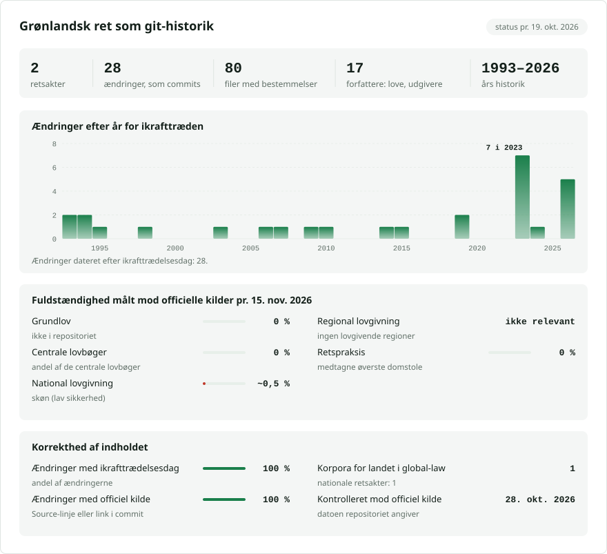

# Grønland: lovhistorik i git

**Dansk** · [English](README.en.md)

<picture>
<source media="(prefers-color-scheme: dark)" srcset="data/da/effort-dark.svg">

</picture>

Grønlands ret som git-historik: én fil pr. paragraf (§), ét commit pr. ændringslov på den dag, den trådte i kraft, og den lov, der foretog hver ændring, som commit'ets forfatter. `git blame` viser loven bag hver linje; `git log` viser alle ændringer af en paragraf; vælger man en dato, får man den tekst, der gjaldt den dag.

En del af [lexifina/global-law](https://github.com/lexifina/global-law), én git-historik for alle landes ret: dette er Grønlands nationale ret, som global-law læser under `greenland/national/acts/`.

**Hvad der er her nu:** 2023 tekster fra Nalunaarutit, Grønlands officielle lovsamling: 934 grønlandske love, forordninger og bekendtgørelser (fra 1979), 874 danske love, anordninger og bekendtgørelser for Grønland (Rigslovgivning) og 215 traktater; 135 lovbekendtgørelser, 569 ændringslove på deres ikrafttrædelsesdag og 294 ophævelser. Kirkeloven (`kirken/`) og havneafgiftsloven (`havneafgift/`) er genskabt ændring for ændring. [`acts.csv`](acts.csv) viser hver mappe; [`held.csv`](held.csv) hvad der er udeladt og hvorfor.

Hver lov er en mappe (`landstingslov-1979-5/`, `rigslovgivning/lov-2025-1766/`, `havneafgift/`, `kirken/`), og hver paragraf er én fil: `havneafgift/par-012.md` er § 12 i havneafgiftsloven, `kirken/par-026a.md` § 26 a i kirkeloven. Hver mappes `README.md` viser dens paragraffer og hvor ofte hver af dem er ændret.

Teksten er på dansk, som Grønlands Selvstyre udgiver den i Nalunaarutit. Den grønlandske tekst, som Selvstyret også udgiver, og en engelsk oversættelse indgår ikke i dette materiale.

## Spørgsmål som git-kommandoer

| Spørgsmål | Kommando |
| --- | --- |
| Alle ændringer af § 12 i havneafgiftsloven | `git log -p --word-diff -- havneafgift/par-012.md` |
| Hvilken lov skrev hver linje i § 12? | `git blame havneafgift/par-012.md` |
| Alle versioner af § 12 med den dag, hver af dem trådte i kraft | `git log --format="%h %(trailers:key=In-force,valueonly,separator=) %an" -- havneafgift/par-012.md` |
| § 12, som den gjaldt den 1. januar 2000 | `python tools/paa_dato.py 2000-01-01 havneafgift 12` |

**Uden for git** stiller vi også dette materiale offentligt og gratis til rådighed:

- **[Spørg Claude om grønlandsk ret](https://global-law.lexifina.com/v1/try_claude?country=greenland)**: åbner Claude med et første spørgsmål klar.
- **[Spørg ChatGPT](https://global-law.lexifina.com/v1/try_chatgpt?country=greenland)**: det samme spørgsmål i ChatGPT.
- **[Søg i grønlandsk ret på vores websted](https://lexifina.com/law?country=greenland&q=havneafgift)**: en søgning efter "havneafgift" med hver bestemmelses tekst og dens versioner, uden konto.
- **[REST API for udviklere](https://global-law.lexifina.com/v1/search_law?query=havneafgift&jurisdiction=greenland)**: den samme søgning som JSON, uden nøgle. Se [dokumentationen her](https://lexifina.com/api/global-law).

Begge assistenter læser materialet gennem den gratis Global law-connector (MCP, `https://global-law.lexifina.com/mcp`); første gang giver chatten dig linket, der tilføjer den. Spørg på dansk eller på engelsk.

**Host det nemt selv.** Det eneste, der kræves, er git og Python, og værktøjerne kører på din egen maskine:

```sh
git clone --depth 1 https://github.com/lexifina/global-law && cd global-law
python3 tools/countries.py add greenland/national/acts
python3 tools/law.py show 2026-01-01 greenland/national/acts/havneafgift/par-012.md
```

Åbnet i Claude Code, Cursor, VS Code eller Codex starter klonen også en lokal MCP-server med de samme værktøjer ([MCP.md](https://github.com/lexifina/global-law/blob/main/MCP.md)).

## Datoer

Hvert commit er dateret kl. 12, America/Nuuk, på den dag, versionen trådte i kraft, og angiver den dag i sin `In-force:`-trailer ved siden af den dag, loven blev vedtaget og betegnet (`Enacted:`):

- for en ændringslov og for hver lov som vedtaget den dag, som dens egen ikrafttrædelsesbestemmelse angiver ("Inatsisartutloven træder i kraft den 1. januar 2019"), citeret i commit'et; hvor den ikke kan læses, dagen for den næste lovbekendtgørelse (`Date-note: undated`);
- for en lovbekendtgørelse den dag, der står i dens betegnelse (nr. 41 af 19. oktober 2026: 19. oktober 2026).

Hver ændring tilskrives den ændringslov, som en lovbekendtgørelses slutnote eller lovens egen ændringsbestemmelse nævner for den paragraf (`Inatsisartutlov nr. 61 af 20. november 2023`); en lovs første version tilskrives loven selv. Ændringer, som mere end én lov kan forklare (nævnt i `Candidate:`-trailere), ændringer, som ingen lov forklarer, ændringer, der er trykt, før deres lov træder i kraft (`Printed-early:`), og hver lovbekendtgørelses egen ordlyd committes af `Nalunaarutit (Grønlands Selvstyre)` og tilskrives aldrig en lov på et gæt.

## Sådan kontrolleres det

- `tools/check_repo.py` læser hver af de 5 officielle tekster tilbage fra git på den dag, den trådte i kraft, og sammenligner den fil for fil med teksten, som den er parset fra Nalunaarutits HTML (0 afvigelser), og ord for ord med hele den officielle side læst uden parseren (12.159 ord, 0 afvigelser).
- `tools/test_repo.py` kontrollerer, at blame nævner en lov, at det daterede værktøj giver teksten før og efter en ændring, at hvert tag kan opløses, og at hvert lovcommit har `In-force:`.
- En anden opbygning fra de samme hentede sider gav samme hash for hvert af de 28 lovcommits og 38 tags. Kommandoerne og resultaterne står i [`REPRODUCE.md`](REPRODUCE.md).
- Historikken udvides kun: senere opbygninger lægges oven på, og intet offentliggjort commit omskrives.
- [vulnerabilities/](vulnerabilities/): mulige redaktionelle fejl i denne ret, fundet af global-laws detektorer og kontrolleret i hånden. Ikke kørt endnu.

## Hvad det ikke viser

- **Teksten mellem officielle versioner** uden for `kirken/` og `havneafgift/`: en ændringslov registreres i lovens mappe `aendringslove/` på sin ikrafttrædelsesdag, men lovens paragraffiler ændres først med den næste officielle lovbekendtgørelse (`Text-applied: no` i commit-beskeden).
- **Selvstyreloven** (lov nr. 473 af 12. juni 2009), Grønlands forfatningsmæssige grundlag: den er en dansk lov, offentliggjort i Retsinformation, og findes i [denmark-law](https://github.com/lexifina/denmark-law/tree/main/lov/2009/473).
- **Dagene mellem de officielle tekster som officielle tekster.** Nalunaarutit udgiver kun en tekst som vedtaget og på hver lovbekendtgørelses dag; ind imellem er hver lovs ændringer placeret på dens egen ikrafttrædelsesdag med den ordlyd, som den næste lovbekendtgørelse viser. Kun de commits, der er tagget `il/2010-9`, `ltl/1992-20` og `lbk/<year>-<number>`, er officielle tekster.
- **Kirkeloven, som den gælder fra 19. oktober 2026 til 31. december 2026.** Den dags lovbekendtgørelse optrykker Inatsisartutlov nr. 29 af 25. juni 2026, der træder i kraft den 1. januar 2027; dens ændringer af § 3 a og § 24 står her fra 19. oktober 2026, mærket `Printed-early:`.

## Kilder

| Kilde | Type | Tidligere versioner | Bemærkninger |
| --- | --- | --- | --- |
| [Nalunaarutit](https://nalunaarutit.gl) (Grønlands Selvstyre) | Officiel elektronisk lovsamling: love som vedtaget og lovbekendtgørelser (Selvstyrets lovbekendtgørelser) | ja, loven som vedtaget og hver lovbekendtgørelse | Teksten til hver version, dens dag og de ændringslove, den indarbejder, med deres ikrafttrædelsesbestemmelser og slutnoter |

## Licens

Se [`LICENSE`](LICENSE). Der er ikke fundet brugsvilkår eller en licens til genbrug på Nalunaarutit, og om grønlandske love er fri for ophavsret, sådan som danske love er (ophavsretsloven § 9), er ikke afgjort her, så der gøres ingen licens til genbrug gældende for lovenes tekst. Kilde: Nalunaarutit, Grønlands Selvstyre, https://nalunaarutit.gl; Grønlands Selvstyre står ikke bag dette repositorie. Historikken, commit-beskederne, tabellerne og værktøjerne er CC0 1.0.

Ingen AI-model har skrevet eller ændret lovtekst; scriptene er skrevet af en AI-model (se [`REPRODUCE.md`](REPRODUCE.md)).

Dette er en oversættelse af den engelske version ([README.en.md](README.en.md)); hvis de afviger, gælder den engelske version.

## Visualiseringer

- [visualisations/](visualisations/): diagrammer tegnet ud fra dette repository. Ikke tegnet endnu.

## Mere

Fra repositoriet [lexifina/global-law](https://github.com/lexifina/global-law) (på engelsk):

- [FEATURES.md](https://github.com/lexifina/global-law/blob/main/FEATURES.md): alle funktioner og hvad hvert korpus skal understøtte (`git blame`, `law.py`, MCP-værktøjer)
- [FAQ.md](https://github.com/lexifina/global-law/blob/main/FAQ.md): spørgsmål og svar · [CONTRIBUTING.md](https://github.com/lexifina/global-law/blob/main/CONTRIBUTING.md): foreslå ændringer · [MCP.md](https://github.com/lexifina/global-law/blob/main/MCP.md): MCP-server · [REPRODUCE.md](https://github.com/lexifina/global-law/blob/main/REPRODUCE.md): hvordan det er bygget · [CHANGELOG.md](https://github.com/lexifina/global-law/blob/main/CHANGELOG.md)
- [FRESHNESS.md](https://github.com/lexifina/global-law/blob/main/FRESHNESS.md): hvor aktuelt hvert korpus er · [Overvågning](https://github.com/lexifina/global-law/tree/main/monitoring): om opdateringerne virker · [WATCHING.md](https://github.com/lexifina/global-law/blob/main/WATCHING.md): hvordan hver officiel kilde overvåges for ændringer
- [performance/](https://github.com/lexifina/global-law/tree/main/performance): hvor hurtige værktøjerne er, målt
- [visualisations/](https://github.com/lexifina/global-law/tree/main/visualisations): diagrammer og forbindelser på tværs af hele verdens ret
- [Sårbarheder](https://github.com/lexifina/global-law/tree/main/vulnerabilities): fejl i retsakter, som de er offentliggjort
